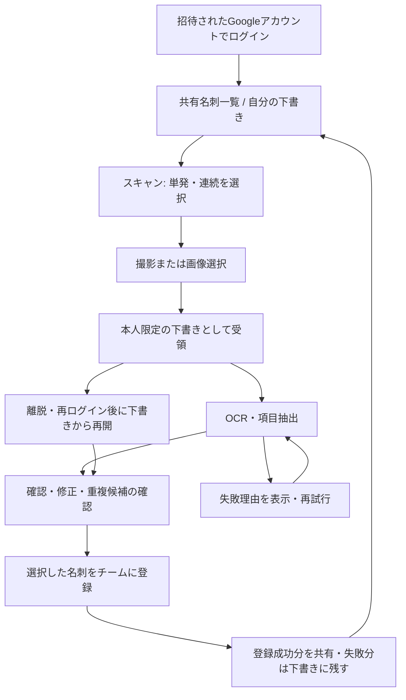

# 名刺インボックス チーム利用・UI/UX改善 実装計画書

作成日: 2026-10-30 / 状態: 実装前の計画案 / 対象: 数人で利用する招待制の共有名刺管理サービス

## 1. 目的・確定条件・対象範囲

目的は、個人向けMVPを「誰が操作したか分かり、作業途中の名刺が消えず、チームで安心して検索・活用できるサービス」に更新することである。

**ユーザー確認済みの条件**

- 登録した名刺はチーム全員で共有する。
- 各自のGoogleアカウントでログインする。
- UIはデジタル庁デザインシステムを使用する。
- 今回は調査と計画書の作成に限定し、プログラムを直接編集しない。

**計画上の推奨初期値。実装着手時に確定する項目**

| 項目 | 推奨案 |
| --- | --- |
| 利用規模 | まず1チーム、3〜10人。負荷試験は5人同時利用・名刺5,000件を基準とする |
| 参加方法 | 管理者がGoogleメールアドレスを事前登録。自由参加・公開サインアップは提供しない |
| 共有開始 | スキャン結果は本人限定の下書き。「チームに登録」の明示操作後に共有 |
| 権限 | 管理者とメンバーの2種類。全員が登録済み名刺を閲覧。編集・ごみ箱移動は原則登録者または管理者 |
| 下書きの保存期間 | 最終更新から7日。削除24時間前から通知。期限は運用方針で変更可能 |
| ごみ箱 | 30日間は復元可能。その後にDB・画像を整合的に削除 |
| 初期スコープ | 個別認証、共有名刺、復元可能な下書き、編集、検索、CSV、管理者によるメンバー管理 |
| 今回含めない機能 | 複数チーム切り替え、一般公開プロフィール、CRM/Google連絡先同期、承認ワークフロー、課金機能、完全オフライン運用 |

「共有範囲」と「編集権限」は別の設定として扱う。全員が他者の名刺も編集できる運用が必要なら、権限表と同時編集テストを変更してから着手する。

## 2. 調査基準と現状

2026-10-30時点のGitHubとローカルコードを確認した。

| 対象 | 確認した状態 |
| --- | --- |
| GitHub `main` | `ad91d22399ebdb6a6453f3937da05488cd23082f`。自動撮影、連続スキャン、一括保存、一覧・検索・削除・CSVを実装 |
| GitHub `develop` / 調査対象 | `3ca6f30e433a5814b7838f632d21f6e60860cef5`。単発/連続切り替え、OCR・ストレージのエラー分類を追加 |
| 未マージPR | [PR #7](https://github.com/TakuyaNakakura/name-card-organizer/pull/7)。直前レビューで未保存データに関する2件を再現済み |
| アプリ構成 | リポジトリ直下のNext.js App Router・React・TypeScript。APIはRoute Handlers。独立した `frontend/`・`backend/` はない |
| 運用構成 | Vercel、PostgreSQL/Neon、S3互換/R2、Google Vision、OpenCV.js。ローカルはDocker Compose |
| 自動テスト | 同一コミットで単体・APIテスト30件と本番ビルドは成功済み。既存E2Eは古い保存UIを参照 |
| 実サービスの状態 | この計画作成ではGoogleの課金状態、全本番環境変数、DB内容を再確認していない。稼働正常を保証する調査ではない |

### 2.1 修正・更新が必要な点

優先度は、P0=現行不具合・公開前の重大な対処、P1=チーム利用開始までに必須、P2=パイロット後に効果を確認して追加、とする。

| ID | 優先度 | 現状・根拠 | チーム利用上の影響 | 対応方針 |
| --- | --- | --- | --- | --- |
| F01 | P0 | `scan-workbench.tsx` の単発保存が未保存キューの有無に関わらず一覧へ遷移 | 他の未保存名刺が失われる | 保存後も下書きが残れば留まる。最終的に下書きをDBで保持 |
| F02 | P0 | OCR中も切り替え可能で、完了処理は開始時の `scanMode` を参照 | 結果が現在のモードでは見えなくなる | 処理中の切り替えを制限。下書きは共通の状態として管理 |
| F03 | P1 | `lib/session.ts` は全員を `sub=admin`・`role=admin` として扱う | 個人の特定、退会者の遮断、操作履歴を実現できない | Google個別認証、失効可能なDBセッション、招待制 |
| F04 | P1 | `lib/db.ts` の名刺に `team_id`・登録者・更新者がない | チーム・利用者の権限判定ができない | 所属・登録者をサーバーで付与し、全DB操作で検証 |
| F05 | P1 | 画像APIは「ログイン済み」だけでストレージキーを取得可能 | 本人限定下書きや削除後の画像を保護できない | 画像を名刺/下書きレコードへ関連付けて認可。権限依存画像は `no-store` |
| F06 | P1 | 下書きはReact状態と30分有効の署名トークン。OCR本文もトークン内 | 再読み込み・離脱・長時間作業・端末変更で復元できない | DB下書き、所有者確認、編集内容の自動保存。トークンを主データにしない |
| F07 | P1 | 自動撮影後に同じ名刺の取り外しを確認する状態がない | 同じ名刺を繰り返し撮影し、OCR利用と確認作業が増える | 撮影後の取り外し待ち、自動撮影の一時停止、再撮影操作 |
| F08 | P1 | 一括保存はクライアントから単票APIへ順次送信。保存APIは毎回新しいIDを発行 | 応答消失後の再試行・二重クリックで重複登録し得る | 下書きID単位の冪等登録と明細別の一括処理結果 |
| F09 | P1 | 正式保存にはメール入力が必須。入力値の型・形式検証は限定的 | メール非掲載の名刺を扱えず、入力の誤りを訂正しにくい | 名前/所属/メールの少なくとも1項目で登録可能にし、入力時のみメール検証 |
| F10 | P1 | 一覧は全件取得、大きなカードを縦に並べる。詳細・保存後編集なし | 数人が増やしたデータを探しにくく、訂正のため再登録が必要 | ページング、検索条件のURL化、詳細・編集、登録者フィルター |
| F11 | P1 | 削除はDBレコードの物理削除と画像のbest-effort削除 | 他者データの誤削除を戻せず、画像だけ残り得る | ごみ箱と復元、監査履歴、再実行可能な画像削除 |
| F12 | P1 | 現行UIは独自配色・影・大きなヒーロー。モードUIは `tablist` と押しボタンが混在 | モバイル操作が遠く、支援技術へ正しい状態を伝えにくい | デジタル庁トークン・部品・文言・操作仕様へ移行 |
| F13 | P1 | 技術状態と全体の「抽出確度%」を常時表示 | 利用者の次の行動が分かりにくい。確度は校正された正解率ではない | 行動を促す状態文言と項目別の「要確認」。技術情報は管理者向け |
| F14 | P1 | `ensureSchema()` がアクセス時にDDL・旧列コピー・制約解除を実行 | 複数インスタンスや誤接続先で想定外の変更が起きる | 専用スキーマ、明示的なバージョン付き移行、実行権限の分離 |
| F15 | P1 | レート制限はIP別のメモリMap | 同じ社内IPの利用者が互いを制限し、インスタンス間では上限が共有されない | DBの原子的カウンターで利用者別・チーム別に制限 |
| F16 | P1 | CSVは引用符エスケープとBOMに対応。数式として扱われる値への対策なし | 共有されたOCR/入力値が表計算ソフトで意図しない数式になり得る | 数式扱いの防止、対象件数確認、エクスポート記録 |
| F17 | P0/P1 | 設定サンプルにも実値らしい資格情報が見られる。DockerはNode 20を指定 | 資格情報の取り扱いとサポート対象ランタイムの確認が必要 | 実値を転載せず、露出履歴を確認して必要な鍵を失効。Node 24 LTS等を別PRで検証 |
| F18 | P1 | モード遷移・権限・復元を確認するブラウザテストがない | ビルド成功だけではチーム操作の破損を検出できない | 利用者2名以上・通信遅延・再試行を含むE2Eを整備 |
| F19 | P2 | 縦長・反射・小文字・和英混在への精度評価が少ない | 読み取り条件によって手直しが増える | 許可された評価画像セットで検出/抽出を測定し、必要な前処理を調整 |

F17のランタイム判断では、Node.js公式の現行リリース表でNode 20がEOLであることを確認した。今回ランタイムやフレームワークのバージョンは変更しない。[Node.jsリリース表](https://nodejs.org/en/about/previous-releases)

## 3. 目指す利用フローと画面構成

### 3.1 全体フロー

「下書きとして自動保存済み」と「チームに登録済み」を明確に区別する。サーバーが受領する前の画像は復元を保証せず、「未送信」と表示する。カメラ起動だけでは画像を外部送信せず、撮影/自動撮影後に送信することを起動前に説明する。

### 3.2 画面と主操作

| 画面 | 主な情報・操作 | 仕様 |
| --- | --- | --- |
| `/login` | Googleでログイン、利用するチーム、招待制の説明 | 招待されていない場合は理由と管理者への連絡方法を表示。秘密鍵やDB設定は表示しない |
| `/cards` | 共有名刺、検索、登録者・登録日フィルター、件数、追加ボタン | ログイン後の標準画面。PCは表、スマホは簡潔なリソースリスト |
| `/scan` | 単発/連続、カメラ、手動撮影、画像選択、下書き件数、一時停止 | モード選択はカメラより上。長い導入文・英語の装飾見出しを減らす |
| `/drafts` | 本人の下書き、解析中/要確認/失敗、選択、一括登録 | 全件のフォームを展開せず、選択した1件を確認。処理失敗だけを絞り込める |
| `/drafts/[id]` | 名刺画像、抽出項目、重複候補、下書き保存状態 | PCは画像とフォームを左右配置。スマホは画像→入力→登録の順 |
| `/cards/[id]` | 詳細、登録者・更新日時、編集、履歴、ごみ箱移動 | 全員閲覧。編集可能かと理由を画面上にも表示 |
| `/settings/members` | 招待先の事前登録、役割、利用停止 | 管理者限定。最終管理者を削除/降格できない |
| `/settings/trash` | 削除者・削除日時・復元 | 本人が削除したもの、または管理者が対象範囲を閲覧 |
| `/settings/operations` | OCR利用数、失敗状況、ストレージ/DBの稼働状態 | 管理者限定。詳細ログへの導線と問い合わせIDを提供 |

PCの共通ヘッダーは「名刺一覧 / スキャン / 自分の下書き」を基本とする。スマホも同じ情報構造を保ち、必要なら公式のボトムナビゲーションを採用する。カメラ操作・ソフトウェアキーボード・セーフエリアと重ならないようにする。

### 3.3 単発スキャン

1. 初回は単発を既定とし、カメラ権限は「カメラを起動」操作で要求する。選択したモードは利用者設定として保持する。
2. 「名刺を枠に合わせる」→「そのまま保持」→「撮影しました」→「読み取り中」を表示する。
3. 読み取り完了後は自動撮影を止め、名刺画像と抽出項目を確認する。カメラの停止/再開を選べる。
4. 「チームに登録」「撮り直す」「下書きで後から確認」を用意する。撮り直しは旧下書きを登録対象から外して置換関係を残す。
5. 登録後は成功を通知し、「次の名刺をスキャン」「一覧を見る」を選べる。他の未保存下書きがあるまま無条件に遷移しない。

### 3.4 連続スキャン

1. 撮影結果ごとにサムネイル・状態・件数を表示し、自動撮影は「一時停止」できるようにする。
2. 撮影直後は同じ名刺が消えるまで再撮影しない。初期調整値は未検出3フレーム連続。実機試験で調整する。
3. 単なるカメラ移動を別名刺と決めつけない。画像ハッシュは同一画像の送信再試行を識別する補助に使い、別撮影の重複は登録前の候補表示で補う。
4. 初版は1ユーザーあたりOCR処理を1件に制限し、「処理中は次を待つ」を明示する。重い並列撮影キュー・バックグラウンドワーカーは必要性を測って追加する。
5. 「読み取りを終了して確認」で下書き一覧へ移動する。確認済みの有効な項目だけを選択して登録し、1件の不備で他の名刺まで登録不能にしない。
6. 一括登録結果は「8件登録、2件要確認」のように明細化し、成功分を再送しない。失敗分は修正・再試行・下書き保持を選べる。

### 3.5 編集・エラー・再開

- フィールドは「名前」「所属」「役職」「メールアドレス」。メールがない名刺も保存対象にする。名前・所属・メールの少なくとも1項目を必須条件とする。
- 不正メールは入力欄の直下に修正方法を示す。「登録できない」の理由をボタンだけの無効状態に閉じ込めない。
- 「抽出確度87%」を正解率のように見せない。要確認項目、未抽出、複数候補を示す。全体スコアは管理者の診断情報へ移す。
- スキャンモードは下書きの保存先を変えない。送信・撮影・登録の処理中は切り替えられないことと理由を示し、完了後に再び操作できるようにする。
- 編集内容は短い間隔でサーバーへ保存し、「保存中 / 下書き保存済み / 未同期」を表示。再読み込み・再ログイン後はDBの下書きを復元する。
- 回線断・401では内容を消さず、一時停止して再接続/再ログインへ誘導する。認証情報を `localStorage` に保存しない。
- カメラ権限拒否、未対応端末、OpenCV失敗では画像選択と手動撮影を案内する。OpenCVの内部状態は通常画面の主情報にしない。

## 4. デジタル庁デザインシステムの適用計画

### 4.1 採用方針

公式サイトの確認時点はデジタル庁デザインシステムβ版 `v2.18.2`。本アプリ向けのローカルデザインシステムを定義し、使用した公式仕様・サンプルのコミット・ライセンスを記録する。公式はコードスニペットを環境に合わせて調整する際も、アクセシビリティの仕組みを維持するよう求めている。[ローカルデザインシステム](https://design.digital.go.jp/dads/guidance/local-design-system/)

- デザインデータは公式Figmaを出発点とし、ログイン・撮影・下書き・一覧・詳細・管理者画面のモバイル/PCワイヤーフレームを先に確認する。
- コンポーネントは公式React/HTMLサンプルから必要分を選び、`components/ui/` に集約する。名称だけを合わせた独自ボタンへの置き換えで完了としない。
- 公式ReactサンプルはReact 19・Tailwind CSS 3を使用している。既存アプリはReact 19・通常CSSのため、初期案は公式HTML/CSSとReactの操作仕様を参照してCSS変数で実装する。Tailwindの全体導入は行わない。
- サンプル由来のARIA、キーボード操作、フォーカス、強制カラーモード対応を保持し、公式Storybookと比較する。複雑な部品で同等性を保てない場合は、フェーズ1で公式React＋Tailwind導入を再評価してADRに残す。
- 確認した公式Reactサンプルの参照コミットは `e637c6820a8ceb5b1c28719e3260afdab89c2b57`。取り込み時にMITライセンスと著作権表示を保存する。[公式Reactサンプル](https://github.com/digital-go-jp/design-system-example-components-react)

### 4.2 見た目と基本仕様

| 項目 | 本アプリの初期案 |
| --- | --- |
| 配色 | 白・公式ニュートラルを土台、主操作は公式の青系キーカラー。成功・警告・エラーの役割を固定する |
| 書体 | 公式採用のNoto Sans JPを基本とし、同梱配信を優先。コード/診断のみに等幅書体を使用 |
| 文字 | 本文・UIは16 CSS px以上を基本にする。通常本文の行高は1.5以上。見出し階層を統一 |
| 余白・角・影 | 公式トークンで規則化。現行の大きな丸角・半透明・重い影・背景グラデーションを整理する |
| レイアウト | 画面幅に追従。スマホは主操作をカメラ付近、PCは確認フォームと画像を並べる |
| 操作サイズ | 本サービスの通常タッチ操作は44×44 CSS px以上を目標とし、公式部品の操作領域を縮めない |
| 状態 | 通常・hover・focus・処理中・無効・エラー・成功・読み取り専用を共通定義 |
| 文言 | 「撮影」「読み取り」「下書き」「チームに登録」を統一。技術用語より次に行う操作を示す |

フォントと文字サイズの根拠は[公式タイポグラフィ](https://design.digital.go.jp/dads/foundations/typography/)。独自の値を追加する場合はローカル仕様へ理由と用途を記録する。

### 4.3 公式部品との対応

| 用途 | 採用する公式部品・扱い |
| --- | --- |
| ログイン以外の主要操作 | ボタン。1画面の主操作を明確化し、登録・撮影・削除を同じ強さにしない |
| 単発/連続モード | スイッチ。両モードのラベルと現在の説明を表示し、変更を即時反映。別途「モードを保存」は不要 |
| 入力・修正 | インプットテキスト、フォームラベル、テキストエリア。必須/任意・補足・エラーを関連付ける |
| 読み取り・登録中 | プログレスインジケーター。処理段階と件数を示し、分からない残り時間を捏造しない |
| 障害・再認証・利用上限 | ノティフィケーションバナー。利用者向け説明と再試行/再ログインの操作を組み合わせる |
| 下書き状態・要確認 | チップラベル。色と文字を併用し、エラーは補足本文でも説明 |
| 名刺一覧 | データテーブル、リソースリスト、検索ボックス、ページナビゲーション |
| 画像アップロード | ファイルアップロード/ドロップエリア。スマホでは通常のファイル選択も常に利用可能 |
| OCR全文・補足 | ディスクロージャー。主操作の下に置き、通常は折りたたむ |
| ごみ箱移動・メンバー停止 | モーダルダイアログ。対象・影響・実行/キャンセルを明記し、閉じたら元の操作へフォーカスを戻す |
| 共通導線 | ヘッダーコンテナ、水平メニュー、必要に応じモバイルメニュー/ボトムナビゲーション |

モードの選択は即時に画面へ反映するため公式スイッチの用途に合わせる。登録対象の選択はチェックボックスで行う。[公式スイッチ](https://design.digital.go.jp/dads/components/switch/)

ログインボタンのGoogleロゴ・配色・余白はGoogleのブランド規定を優先し、周辺のフォームとレイアウトをデジタル庁仕様へ合わせる。[Googleログインのブランドガイド](https://developers.google.com/identity/branding-guidelines)

### 4.4 アクセシビリティ受け入れ基準

- WCAG 2.2 AAを開発目標とする。採用しただけで適合を宣言せず、対象画面と試験結果を記録する。
- 通常文字のコントラスト4.5:1、意味を持つ非テキストUIのコントラスト3:1を基本とし、部品ごとの例外は公式仕様に従う。
- Tab・Shift+Tab・Enter・Spaceで主要操作が完結する。モーダル以外でキーボードフォーカスを閉じ込めない。
- 見出し、ランドマーク、フォームラベル、`aria-describedby`、`aria-invalid` を正しく関連付ける。
- 処理進行と完了は `role=status` 等で通知。検出ループの更新を毎フレーム読み上げない。
- 320 CSS px相当、文字拡大200%、ズーム400%で主要操作が欠落しない。データ表は見出し関係を保った専用の横スクロール領域を許容する。
- VoiceOver/iPhone、キーボード、強制カラーモード、動きを減らす設定で確認する。自動撮影に依存せず手動撮影/画像選択でも完了できる。

デジタル庁の部品で満たせるのは画面全体のアクセシビリティの一部であり、撮影や確認フロー自体の試験も行う。[公式アクセシビリティ](https://design.digital.go.jp/dads/guidance/accessibility/)

## 5. 認証・権限・共有範囲

### 5.1 Google個別認証

推奨ライブラリはBetter Auth。Next.js・Google・PostgreSQLの公式対応を利用し、Next.js 15/React 19での小さな検証後にバージョンを固定する。既存の `jose` にOAuth/OIDC手順を足す自作認証は行わない。Auth.jsの公式移行案内も、新規導入にはBetter Authを推奨している。[公式移行案内](https://authjs.dev/getting-started/migrate-to-better-auth)

1. 管理者が参加可能なメールアドレスと役割をDBへ登録する。初版では招待メール自動送信は必須とせず、招待済み一覧とログインURLを提供する。
2. GoogleのAuthorization Codeフローを使用する。必要なスコープは `openid email profile` に限定し、Drive/Gmailのアクセス権は要求しない。
3. ライブラリで署名・issuer・audience・state・nonce等を検証し、Googleで確認されたメールと有効な招待を照合する。
4. 初回にGoogleの `sub` を利用者へ結び付ける。以降はメール文字列だけを恒久IDにしない。GmailとWorkspaceの両方を想定し、ドメインだけで参加を許可しない。
5. DBセッションを使用し、毎回の保護API/画像取得で所属の有効状態を検証する。メンバー停止は次の要求から反映する。長時間の権限キャッシュは使わない。
6. 共有管理者パスワードの入口はチーム版の本番から廃止し、旧セッションを受け付けない。緊急復旧は監査可能な管理者向け手順で行う。

Googleログイン用のOAuthクライアントと、OCR用サービスアカウントは別物である。個人のログイン資格情報でVisionを実行する構成にはしない。[Google OIDC](https://developers.google.com/identity/openid-connect/openid-connect)、[Better Auth Google](https://better-auth.com/docs/authentication/google)

### 5.2 初期の権限表

| 操作 | メンバー | 管理者 |
| --- | --- | --- |
| 登録済み名刺の検索・画像閲覧・CSV出力 | チーム内全件 | チーム内全件 |
| 下書きの閲覧・編集・破棄 | 自分のもののみ | 原則自分のもののみ。管理者にも下書きを自動公開しない |
| 名刺の登録 | 自分の下書きから | 自分の下書きから |
| 登録済み名刺の編集・ごみ箱移動 | 自分の登録分 | チーム内全件 |
| ごみ箱から復元 | 自分の登録分 | チーム内全件 |
| メンバー招待・停止、役割設定 | 不可 | 可。最後の管理者を保護 |
| 運用診断・利用上限設定 | 不可 | 可 |

CSVを持ち出せる範囲は共有名刺の閲覧範囲と一致させる。CSV出力の記録を残す。退会者の登録済み名刺はチームに残し、登録者情報は「利用停止済み」として保つ。退会者の下書きは運用規程に沿って期限後に削除する。

認可は画面だけでなくサービス/DB取得・画像配信・CSV・一括処理・復元の各入口で実施する。`teamId` や `ownerId` をブラウザの値だけで決めない。存在を明かせないレコードは404、許可されない既知の操作は403を基本とする。

## 6. データ・API・実行フローの変更

### 6.1 データ構造案

既存の `public.cards` を無差別に補正する方式を終了し、アプリ固有の `name_card` スキーマへ段階移行する。認証テーブルは `name_card_auth` 等へ分離する。認証ライブラリのユーザーID型に合わせて外部キーを定義する。

| データ | 主な項目・制約 |
| --- | --- |
| 認証ライブラリの利用者・アカウント・セッション | GoogleプロバイダーID、セッション有効期限。ライブラリが生成するスキーマをレビューして移行管理へ取り込む |
| `teams` | チーム名。初期は1件のみ |
| `team_memberships` | `team_id, user_id, role, status`。組み合わせ一意 |
| `invitations` | 招待メール、役割、期限、招待者、参加済み/取消状態 |
| `scan_drafts` | チーム、所有者、`client_scan_id`、抽出値と編集値、OCR状態、エラー、バージョン、期限、登録先ID |
| `business_cards` | 現行4項目、チーム、登録者・更新者、登録元下書きID、バージョン、削除者・削除日時。メールはnull許容 |
| `assets` | ストレージキー、画像種別、チーム、下書き/正式名刺の関連、サイズ、保持期限、削除状態 |
| `audit_events` | 誰がいつ何を登録・編集・削除・復元・出力・停止したか。原則IDと操作種別を保持し、OCR全文や資格情報を複製しない |
| `usage_counters` | 利用者/チーム・期間・OCR実行回数。原子的更新と期限付き集計 |
| 移行履歴 | 適用済みバージョンとチェックサム。CLI/CIからのみ更新 |

下書きの `(team_id, owner_id, client_scan_id)` と正式名刺の登録元下書きIDに一意制約を設ける。同じメールが複数人・複数部署で使われることはあるため、メール自体を一律の一意制約にはしない。

### 6.2 状態管理と耐障害性

撮影の状態と、各下書きの処理状態を分離する。モードは撮影後の画面動作だけを変え、データの保存先を分けない。

| 対象 | 状態と遷移 |
| --- | --- |
| カメラ | `off → starting → searching → stabilizing → capturing → waiting_for_removal`。別途 `paused` と権限/機器エラー |
| 下書き | `uploading → processing → ready / needs_input / failed → confirmed`。`discarded / expired` は登録不可 |
| 登録操作 | `idle → saving → saved / failed`。失敗しても下書きと修正値を保持 |

初版は同期Route Handler内でOCRを実行するが、受付時点で下書きIDと所有者をDBへ記録する。処理開始/完了も更新し、タイムアウトや中断で止まった行を期限付きの実行リースで検出する。完了が不明なものを無限に自動再試行しない。

下書き登録はDBトランザクション内でロック/一意制約を使い、同じ下書きからの登録は既存の名刺IDを返す。画像のR2操作とDBトランザクションは一体にはならないため、削除・一時ファイル回収は状態を記録して再実行する。

OCR自体の厳密な一回実行は保証できない。外部OCRの成功直後にプロセスが落ちるケースでは実行結果が不明になり得るため、再試行による料金が発生し得ることを運用で扱う。アプリ内の名刺登録重複防止とは分けて設計する。

### 6.3 API契約の更新案

以下は実装時に追加/変更する案であり、現時点で呼び出せる新APIではない。

| API | 契約・変更点 |
| --- | --- |
| `/api/auth/[...all]` | 認証ライブラリのGoogleログイン/セッション/ログアウト。旧パスワードAPIと切り替える |
| `POST /api/scans` | 画像と `clientScanId` を受領。DB下書きID、状態、抽出/編集フィールドを返す。巨大なOCR本文入りJWTへの依存を廃止 |
| `GET /api/drafts` | 自分の有効下書き、状態別件数、ページング。登録済み・他人の下書きを混在させない |
| `GET/PATCH /api/drafts/[id]` | 本人だけ取得/自動保存。`expectedVersion` で同時編集を検出 |
| `POST /api/drafts/[id]/retry` | 所有者・状態・上限を検証して再解析。編集中の値は利用者の同意なく上書きしない |
| `POST /api/cards` | `draftId, expectedVersion` と確認値を受領。利用者・チームはサーバー側で決め、登録済みなら同じ名刺を返す |
| `POST /api/cards/batch` | 件数制限付きで下書きID/バージョン/確認値を受領。明細ごとに `{draftId, cardId, outcome, error}` を返す。1件ごとに原子的登録 |
| `GET /api/cards` | `q, cursor, limit, createdBy, from, to`。配列から `{items, nextCursor, total}` へ変更。初期ページ25件、最大100件 |
| `GET/PATCH /api/cards/[id]` | チーム内詳細取得、権限のある更新。競合時は409と最新バージョンを返し、入力を保持 |
| `DELETE /api/cards/[id]` | 物理削除からごみ箱移動へ変更。登録者/管理者を検証 |
| `POST /api/cards/[id]/restore` | 復元権限と期限を検証 |
| `GET /api/cards/export` | ページングとは別に検索条件全体/明示選択を対象にする。件数上限・数式対策・監査を適用 |
| `GET /api/assets/[assetId]` | 任意ストレージキーからDB上の画像IDへ変更。共有名刺/本人下書きの権限を検証 |
| `/api/admin/members` 等 | 招待・停止・役割変更。管理者限定、最後の管理者の保護 |
| `/api/maintenance/cleanup` | スケジュール実行専用。期限下書き/ごみ箱/孤立画像の削除を再試行可能に処理 |

API変更と同じPRで `lib/types.ts`、`scan-workbench.tsx`、名刺一覧・編集・削除部品、CSV呼び出し、テストを更新する。新フロントエンドだけを旧APIへ接続しない。

共通エラーは `{error: {code, message, requestId, fields?, retryable?}}` へ統一する案とする。401/403/404/409/413/422/429/502/503を用途で使い分け、移行時に現行 `{error: string}` との互換期間/同時切り替えを決める。内部例外・SQL・接続文字列は画面に返さない。

### 6.4 重複と同時編集

- 登録前に正規化メールの完全一致、名前＋所属などを重複候補として表示する。表記の正規化前の入力も保持する。
- 同じメールでも別人である可能性を残し、「既存名刺を見る」「下書きを破棄」「別名刺として登録」を選べる。自動統合しない。
- 他者の名刺を更新する権限がない場合は上書き導線を出さず、管理者へ確認する案内を表示する。
- 編集はバージョンを条件に更新する。競合した場合は自分の入力と現在の値を示し、後から保存した人が黙って上書きする動作を避ける。

### 6.5 画像・負荷・利用料金

- 現行の圧縮を維持しつつ、圧縮後の上限チェックを必ず行う。初期値は1画像1.8MB、2画像合計とmultipartを含め3.8MB以内とする。超過時は追加縮小または送信前の案内に切り替える。
- Vercel Functionのリクエスト本文上限を超えないことを確認する。初版ではR2直接アップロードは追加せず、必要時に署名URL・サイズ/所有者検証を含めて設計する。[Vercel Functions制限](https://vercel.com/docs/functions/limitations)
- MIME名だけを信用せず実画像の形式・デコード可能性・画素数を検証する。未対応形式は分かるメッセージにし、HEIC等の対応は実機結果から決める。
- OpenCVは必要時に読み込み、検出を低解像度・間引きで実施。ページ非表示時は停止し、長時間利用のメモリ・発熱を計測する。
- 利用制限はIP単位の補助に加えて、ユーザー/チームの原子的カウンターで制御する。初期上限値はパイロット前に合意する。
- OCR実行数・再試行数・失敗段階を個人情報なしで集計する。Google側の予算通知とアプリの実行上限は別に管理し、無制限の自動再試行をしない。
- クリーンアップは「期限切れかつ名刺から未参照」であることをDBで確認する。`drafts/` プレフィックスの画像を一律削除しない。正式名刺の画像を巻き込まないためである。

## 7. インフラ・環境設定・運用

### 7.1 推奨する実装構成

- Next.js・Route Handlers・PostgreSQL・R2・Google Vision・OpenCVは継続する。少人数のために独立バックエンド、WebSocket、大規模ジョブ基盤を新設しない。
- 認証は `better-auth` と公式PostgreSQL接続に必要な `pg` 等を候補とする。認証以外の既存 `postgres` 利用を全面的に書き換えない。2つのプールの合計接続数を小さく制限し、Neonのプーラーと互換性を確認する。[公式PostgreSQL対応](https://better-auth.com/docs/adapters/postgresql)
- 認証処理と `requireTeamSession()` はNode.js側で実施する。MiddlewareのCookie有無判定だけで認可しない。[公式Next.js連携](https://better-auth.com/docs/integrations/next)
- `ScanWorkbench` は撮影・モード設定・下書き一覧・確認フォーム・登録操作へ小さく分割する。クライアント部品はカメラ/入力/即時更新に限定し、一覧・詳細の初期取得は既存のServer Component方針を継続する。
- デザイン部品・画面仕様・API型は先に定義し、各フェーズの縦断的な機能ごとに接続する。

### 7.2 新規/変更予定の環境設定

| 設定 | 用途・移行 |
| --- | --- |
| `GOOGLE_CLIENT_ID`, `GOOGLE_CLIENT_SECRET` | ユーザーログイン用OAuthクライアント。Visionのサービスアカウントとは別 |
| `BETTER_AUTH_SECRET`, `BETTER_AUTH_URL` | 認証ライブラリの秘密情報と環境ごとの正規URL。名称は導入バージョンで再確認 |
| `DATABASE_URL` | アプリの通常接続。専用DB/スキーマへ限定、DDL権限を持たせない |
| `DATABASE_MIGRATION_URL` | 管理された移行時のみ使う接続。通常のVercel Functionへ配らない |
| `CRON_SECRET` | クリーンアップ呼び出しの認証。個人セッションとは分ける |
| 既存Vision/R2設定 | 継続。Previewは本番名刺を使わない専用バケット/プレフィックスと鍵へ分離 |
| `ADMIN_PASSWORD(_HASH)`, 旧 `SESSION_SECRET` | チーム版への切り替え後に公開ログイン用途から廃止。必要な移行中の用途を棚卸し |
| `E2E_BYPASS_AUTH` | 公開環境では禁止を維持。新認証はテスト専用IDで権限試験を行い、バイパスだけで正常判定しない |

Google CloudでOAuth同意画面・利用対象・テスト利用者/公開状態を確認し、本番と検証用の正確なコールバックURLを登録する。固定のPreview用URLを用意し、任意のPreviewドメインをワイルドカード許可しない。リダイレクト先は同一サービス内へ制限する。

初回管理者は管理されたセットアップ処理で1回だけ登録する。「最初にログインした誰かを自動で管理者にする」方式は採用しない。

### 7.3 セキュリティ・運用整備

- 認証ライブラリのCSRF/Origin検証を有効にし、独自の登録・削除APIにも同一Origin検証/CSRF対策を適用する。
- CSPはGoogleへのページ遷移型ログインを基準に最小限調整する。外部フォントやGISのiframeを導入する場合だけ必要な許可を追加する。包括的なワイルドカード許可はしない。
- WASMの実行要件を維持しつつ、`unsafe-eval` の除去可否を別の検証項目にする。既存のカメラ機能を壊して一括強化しない。
- 認証情報はVercelのサーバー環境変数に保存し、`NEXT_PUBLIC_` やブラウザ配信物に含めない。サンプルはプレースホルダーだけに置換する計画とする。
- 名刺画像・OCR本文・認証Cookieはアプリログに出さない。サーバーログには問い合わせID、エラー分類、外部エラーの安全な識別コードと処理時間を残す。
- DB接続診断は管理者限定にし、一般メンバーへDBユーザー名やSQL詳細を返さない。
- 利用目的、チーム共有される範囲、Google Vision/R2に送られるデータ、保持期限、削除/停止の窓口を説明する。実際の組織の情報管理方針に合わせて確認する。
- DockerとVercelのNode.jsを対応LTSへ揃える。Next.js/Reactの更新は互換性・サポート状況を確認した別PRとし、このUI変更へ無条件に混ぜない。

## 8. 実装フェーズ・成果物・工数

工数は設計・自動テスト・移行を含む暫定のエンジニア人日。Google Cloud設定の待ち時間、利用者レビュー、追加要件は含まない。合計25〜40人日を初期見積もりとし、フェーズ1終了時に再見積もりする。

| 段階 | 作業と成果物 | 対応ID | 依存 | 暫定工数・完了条件 |
| --- | --- | --- | --- | --- |
| 0. 現行PRの安定化 | 未保存データ消失と処理中切り替えを修正、回帰試験。資格情報の扱いを確認 | F01,F02,F17 | なし | 1〜2日。レビューの2パターンが再現しない。PR #7は修正後に再レビュー |
| 1. 仕様・デザイン基盤 | 主要画面ワイヤーフレーム、権限/保持期限合意、DADSローカル仕様、認証互換性PoC、移行設計 | F03〜F06,F12,F13,F14 | 0 | 3〜5日。モバイルの撮影→確認→登録を試作で利用者が完了できる |
| 2. 認証・データ境界 | Google招待制、DBセッション、メンバー停止、専用スキーマ、資産認可、明示的移行、ランタイム検証 | F03,F04,F05,F14,F17 | 1 | 6〜9日。別人/未招待/停止ユーザーによる不正取得が拒否される |
| 3. 下書きと撮影・登録 | 共通状態管理、DB下書き・自動保存、取り外し待ち、再試行、冪等登録、一括結果。撮影/確認画面をDADS化 | F01,F02,F06,F07,F08,F09,F12,F13,F15 | 2 | 7〜10日。離脱復元・通信応答消失・連続10枚・一部失敗を通す |
| 4. 共有名刺の運用 | DADS一覧/詳細/編集、検索とページング、重複候補、競合検出、ごみ箱/復元、CSV、監査・管理画面 | F10,F11,F12,F16 | 2,3 | 4〜7日。共有/編集権限どおりに操作でき、検索条件とCSV対象が一致 |
| 5. 品質確認・移行・試行運用 | E2E更新、アクセシビリティ/実機/負荷試験、データ移行リハーサル、利用説明、運用手順 | F18,F19、全P1 | 3,4 | 4〜7日。下記受け入れ基準を満たし、2〜3人でパイロット |

大きな1本のPRにせず、認証・移行・撮影・一覧の単位で分割する。権限の完成前に新しい利用者を本番へ招待しない。DADSの基礎部品は段階1で作り、画面への適用は各機能フェーズに含める。

### 8.1 主な変更予定ファイル

| 対象 | 予定する変更 |
| --- | --- |
| `components/ui/`, `app/globals.css` | DADS部品、トークン、状態・フォーカス、公式コードの出典記録 |
| `app/(protected)/layout.tsx`, `app/(auth)/login/page.tsx` | チーム/利用者表示、共通導線、Googleログイン |
| `components/scan/`, `app/(protected)/scan/` | カメラの状態分離と小部品化、共有下書きモデルへの接続 |
| `app/(protected)/drafts/`, `app/(protected)/cards/` | 下書き再開、詳細・編集・一覧の追加/更新 |
| `lib/auth*`, `lib/http.ts`, `lib/session.ts` | Google認証、所属/権限確認。旧管理者トークンと下書きJWTを移行 |
| `lib/db.ts`, `db/migrations/`, 移行スクリプト | スコープ付きCRUD、専用スキーマ、バージョン付き移行。リクエスト時DDL撤去 |
| `lib/scan-service.ts`, `lib/storage.ts`, `lib/card-service.ts` | 下書き受付、所有者・画像関連、冪等登録、ごみ箱と削除の整合性 |
| `app/api/`, `lib/types.ts`, `lib/csv.ts` | 新契約、認可、検索/CSVの範囲、入力検証、共通エラー |
| `Dockerfile`, Compose、`next.config.ts`, envサンプル | 検証用設定、認証コールバック、サポートLTS、必要なCSP/保持処理 |
| `tests/`, `playwright.config.ts`, CI | 旧E2Eの修正、利用者別試験、遅延・再試行、DADS操作の回帰検証 |

## 9. データ移行・リリース・ロールバック

以前に別サービスの `cards` と衝突した経緯があるため、接続先が正しいことと旧データの出自を確認してから移行する。別サービスのテーブル・制約には手を加えない。

1. 本サービス専用のNeon Project/Branch/Databaseを記録し、DB接続先と対象テーブルを確認する。R2の参照画像も棚卸しする。
2. 現行DBをバックアップし、別の検証用DBへ復元する。名刺件数・ID・主要項目・画像キーを基準表として保存する。
3. 専用スキーマ・認証・チーム・下書き等をバージョン付きSQLで追加する。アプリの起動/一覧表示を移行処理のトリガーにしない。
4. 初回管理者とチームを作成し、本アプリ由来と確認できた旧名刺だけをコピーする。ID・日時・原文・画像参照を保存し、既存画像へ認可用の関連レコードを作る。
5. 旧レコードの登録者が不明なら「旧版から移行」と表示する。実際に操作した移行者と過去の登録者を混同しない。管理者だけが訂正できる初期状態にする。
6. 件数・フィールド・CSV・画像取得・権限・復元を照合する。元の `public.cards` と旧画像は削除しない。
7. 本番切り替え時は現行アプリの書き込みを一時停止し、最終差分を移して照合する。古い公開デプロイから旧DBへ書き込めない状態を確認する。
8. 新認証へ切り替えて2〜3人を招待し、パイロット後に全員へ展開する。旧管理者ログインと旧画像URLは拒否/新しい認可経路へ置換する。
9. 保持期間・利用状況を確認してから、別途合意した手順で旧テーブル/資格情報を整理する。

**ロールバック条件**

- 新版でまだ書き込みを再開していなければ、バックアップと旧環境の保全状態を確認して切り戻せる。ただし共有管理者ログインをチーム向けに再公開しない。
- 新版で書き込みを再開した後は、旧DBへの接続切り替えだけでは新しいデータが失われる。まず書き込み停止し、新スキーマと認証を保った修正リリースを優先する。
- やむを得ず旧方式へ戻す場合は、差分・削除状態・所属/権限を検証してから移送する。画像の削除は進めず、無損失を確認するまでは旧資産を保持する。

## 10. テスト・受け入れ条件

アプリコードを変更する実装フェーズでは、対象の単体/API試験→Composeビルド→コンテナ起動→ブラウザE2E→実機の順で確認する。外部OCRは通常の自動テストではモックにし、実API疎通は許可されたテスト画像と限られた回数で行う。

| 分類 | 最低限の受け入れ条件 |
| --- | --- |
| 招待/認証 | 招待済み2名が別Googleアカウントで参加可能。未招待、取消、停止済み、失効セッションは保護API/画像へアクセス不可 |
| 権限 | Aの下書きをBがID直接指定・画像URL・一括API経由で取得/登録できない。登録後はA/Bとも閲覧できる |
| 操作権限 | 他者登録分の更新/削除は一般メンバーには不可、管理者には可。最後の管理者は失われない |
| 現行回帰 | 連続A→単発B保存でAが残る。OCR待ち/登録待ちにモード変更しても結果が隠れず、消えない |
| 下書き復元 | サーバー保存済み結果・修正値が再読み込み、ログアウト/再ログイン後も復元。旧30分を超えても保持方針内なら再開可能 |
| 自動撮影 | 同じ名刺を固定したまま繰り返し追加しない。取り外し→次の名刺で再開。一時停止・手動撮影も可能 |
| 連続登録 | 10枚中2枚の入力不備/外部エラーがあっても、有効な8枚を1回ずつ登録し、失敗2枚は修正可能 |
| 冪等性 | 保存成功後に応答を落として再試行しても名刺は1件。二重クリック/別タブでも同じ下書きから重複作成しない |
| 編集競合 | 同じ名刺/下書きを2タブで更新した場合に409を検出し、上書き前に本人入力を保持できる |
| 検索/一覧 | 5,000件で25件ページング。名前・所属・役職・メール・登録者の条件を再読み込み後も維持 |
| CSV | 対象件数・検索範囲・権限を一致させ、UTF-8 BOM/改行・引用符・日本語・数式開始文字を検証 |
| 削除/復元 | ごみ箱へ移動後は通常一覧・通常CSVから消える。期限内復元で画像も表示。クリーンアップ再実行で登録済み画像を削除しない |
| エラー | 権限拒否、401、409、413、429、OCR課金/認証/タイムアウト、R2失敗で理由と次の操作を表示。入力を消さない |
| アクセシビリティ | キーボード・VoiceOver、コントラスト、ズーム、フォーカス復帰、ライブ通知を確認。自動検査の重大/深刻項目0件に加えて手動確認を記録 |
| 実機 | iPhone Safari/Android Chrome/PCで、縦横名刺・反射・暗所・和英混在を確認。許可された名刺各10枚以上を使用 |
| 性能目標 | 5人同時でエラーなく利用。検証環境の一覧応答p95は2秒以内を暫定目標、OCRは外部処理を分離して計測。達成しない場合は再計測と改善計画を残す |
| 移行 | 旧DBと移行後の件数・ID・日時・主要項目・画像参照が一致。別サービスのDB/テーブルに変更なし |

チーム利用開始の必須条件は、全P0/P1の完了、権限試験・データ消失回帰・復元試験の成功、主要画面のDADS対応、利用者2〜3名による操作確認である。OCRの認識正解率は評価セットで基準値を測り、期待値を合意してから改善目標を定める。

## 11. 実装前に確定する残りの事項

| 項目 | 初期案・確認先 |
| --- | --- |
| 編集範囲 | 登録者と管理者。全員編集が必要かをチーム責任者と確認 |
| 保存期間 | 下書き7日/ごみ箱30日。正式名刺と原画像の長期保持方針も合わせて合意 |
| CSVの持ち出し | 全メンバー許可を初期案とする。組織の情報管理方針により制限する場合は権限表を変更 |
| Googleアカウント | Workspace/Gmailの混在、OAuth同意画面の対象と検証用URLを確認 |
| 利用量 | 月の枚数、ピーク時の連続枚数、OCRのユーザー/チーム上限、予算通知先を決める |
| メールがない名刺 | 少なくとも名前/所属/メールの1項目があれば共有登録できる案を確認 |
| 運用責任者 | 招待管理、データ削除、障害通知、バックアップ復元の担当者を決める |

## 12. 一次資料

すべて2026-10-30に確認。DADSの版と認証ライブラリのAPIは、実装開始時に再確認して採用版を固定する。

- [デジタル庁デザインシステム: 使い方](https://design.digital.go.jp/dads/guidance/how-to-use/)
- [ローカルデザインシステム](https://design.digital.go.jp/dads/guidance/local-design-system/)
- [アクセシビリティ](https://design.digital.go.jp/dads/guidance/accessibility/)
- [タイポグラフィ](https://design.digital.go.jp/dads/foundations/typography/)、[カラー](https://design.digital.go.jp/dads/foundations/color/)
- [コンポーネント一覧](https://design.digital.go.jp/dads/components/)、[インプットテキストのアクセシビリティ](https://design.digital.go.jp/dads/components/input-text/accessibility/)
- [スイッチ](https://design.digital.go.jp/dads/components/switch/)、[通知バナー](https://design.digital.go.jp/dads/components/notification-banner/)、[進行表示](https://design.digital.go.jp/dads/components/progress-indicator/)、[モーダル](https://design.digital.go.jp/dads/components/modal-dialog/)
- [公式Reactコードスニペット](https://github.com/digital-go-jp/design-system-example-components-react)、[MITライセンス](https://github.com/digital-go-jp/design-system-example-components-react/blob/main/LICENSE)
- [Google OpenID Connect](https://developers.google.com/identity/openid-connect/openid-connect)、[ログインボタンのブランドガイド](https://developers.google.com/identity/branding-guidelines)
- [Better Auth: Next.js](https://better-auth.com/docs/integrations/next)、[Google](https://better-auth.com/docs/authentication/google)、[PostgreSQL](https://better-auth.com/docs/adapters/postgresql)
- [Auth.js公式: Better Authへの移行案内](https://authjs.dev/getting-started/migrate-to-better-auth)
- [Vercel Functions制限](https://vercel.com/docs/functions/limitations)、[Node.jsリリース表](https://nodejs.org/en/about/previous-releases)

本計画書は方針と作業順序を定めたものであり、プログラム、DB、Vercel、Google Cloud、R2の設定を変更・実行したものではない。
